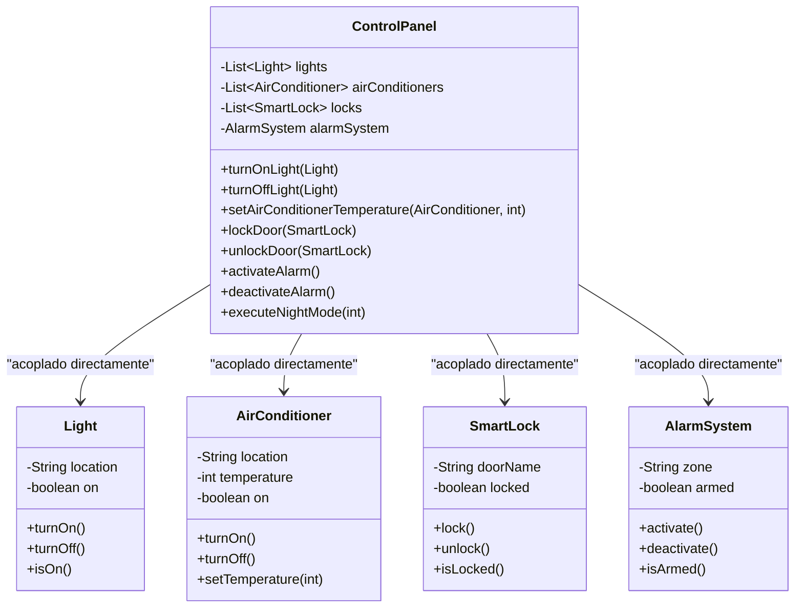
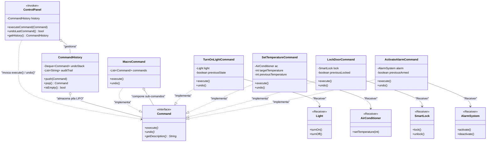

# 1. Nombre del proyecto

**BuildingSmart: Sistema Inteligente de Automatización de Edificios basado en el Patrón de Diseño Command**

---

# 2. Objetivo académico

El objetivo principal de este proyecto es demostrar de forma práctica y comparativa el impacto arquitectónico del patrón de diseño de comportamiento **Command** (*Gang of Four*). 

Para ello, se modela un **Sistema de Automatización de Edificios Inteligentes** (*Building Automation System*) encargado de controlar cuatro familias de dispositivos: **luces (`Light`), climatización (`AirConditioner`), cerraduras electrónicas (`SmartLock`) y alarmas de seguridad (`AlarmSystem`)**.

El desarrollo aborda de forma explícita:
1. **La transición arquitectónica:** Contrastar una implementación inicial con **alto acoplamiento** frente a una solución desacoplada y orientada a objetos.
2. **El principio de Inversión de Dependencias y Open/Closed (SOLID):** Permitir la incorporación de nuevas operaciones y dispositivos sin alterar el panel invocador.
3. **Soporte transaccional reversible (Undo):** Garantizar la reversibilidad exacta de acciones individuales y compuestas mediante estructuras LIFO.
4. **Composición de comandos complejos:** Implementar el **Modo Noche** mediante `MacroCommand`, demostrando la reversión simétrica en orden inverso ($N-1 \rightarrow 0$).
5. **Interfaz Gráfica Táctil (GUI):** Validar reactivamente el patrón en una aplicación visual estilo tablet domótica (Dark Mode / Glassmorphism).

---

# 3. ¿Qué es el patrón Command?

El patrón **Command** es un patrón de diseño **de comportamiento** catalogado por el *Gang of Four* (GoF) cuyo propósito fundamental es:

> *"Encapsular una petición como un objeto, permitiendo parametrizar a los clientes con distintas peticiones, encolar o registrar peticiones y soportar operaciones que se pueden deshacer (Undo)."*  
> — Gamma, Helm, Johnson & Vlissides (1994)

### Analogía Conceptual: La Comanda en un Restaurante
* **Sin patrón:** El cliente entra a la cocina y le da órdenes verbales directas a cada cocinero sobre qué sartenes usar y cómo freír los ingredientes. Si cambia el personal de la cocina, todo colapsa.
* **Con patrón Command:** El mesero anota la solicitud en una **comanda de papel** (el `Command`). La comanda contiene qué plato preparar, los ingredientes, la mesa y el receptor (el cocinero correspondiente). El mesero (**Invoker**) no necesita saber cocinar; solo despacha la comanda. Y si el cliente cancela la orden, la comanda permite deshacer la preparación antes de servirla.

---

# 4. Problema que se pretende resolver

En sistemas de automatización física o domótica, los componentes de interfaz de usuario (paneles de pared, apps móviles, temporizadores) necesitan operar hardware heterogéneo.

### Deficiencias del enfoque tradicional (ANTES de aplicar Command):
1. **Alto Acoplamiento (*Tight Coupling*):** La clase `ControlPanel` debe importar y almacenar referencias directas a `Light`, `AirConditioner`, `SmartLock` y `AlarmSystem`. El panel depende íntimamente de la firma de métodos de cada clase concreta.
2. **Violación del Principio Abierto/Cerrado (OCP):** Si el edificio incorpora persianas inteligentes (`SmartBlinds`) o sensores de incendio, es obligatorio abrir, modificar y recompilar `ControlPanel`, elevando el riesgo de regresiones.
3. **Imposibilidad de Deshacer (*Undo*) Genérico:** No existe un mecanismo estándar para recordar el estado previo. Revertir requeriría programar lógica condicional dispersa y frágil en cada método del panel.
4. **Falta de Trazabilidad y Auditoría:** Las órdenes se ejecutan y se pierden inmediatamente en memoria; no pueden encolarse, auditarse cronológicamente ni reintentarse ante fallos.
5. **Modo Noche Monolítico y Rígido:** La secuencia de apagado general y aseguramiento queda *hardcodeada* dentro de un método del panel, impidiendo su reutilización en otros mandos o contextos.

---

# 5. Arquitectura y participantes del patrón

El diseño desacoplado divide las responsabilidades en los siguientes participantes canónicos:

| Participante GoF | Clase en el Proyecto | Rol y Responsabilidad |
|---|---|---|
| **Command (Interfaz)** | [`Command.java`](src/com/building/automation/after/command/Command.java) | Declara los métodos obligatorios `execute()`, `undo()` y `getDescription()`. |
| **Concrete Command** | [`TurnOnLightCommand.java`](src/com/building/automation/after/command/TurnOnLightCommand.java) | Encapsula el encendido/apagado de iluminación; almacena `previousState` para restaurar en `undo()`. |
| **Concrete Command** | [`TurnOffLightCommand.java`](src/com/building/automation/after/command/TurnOffLightCommand.java) | Encapsula el apagado explícito de luces con reversión a su estado anterior. |
| **Concrete Command** | [`SetTemperatureCommand.java`](src/com/building/automation/after/command/SetTemperatureCommand.java) | Configura temperatura del aire acondicionado; guarda `previousTemperature` y `previousPowerState` para restaurar con fidelidad. |
| **Concrete Command** | [`LockDoorCommand.java`](src/com/building/automation/after/command/LockDoorCommand.java) | Controla el bloqueo de cerraduras; guarda `previousLocked` para desbloquear en `undo()`. |
| **Concrete Command** | [`UnlockDoorCommand.java`](src/com/building/automation/after/command/UnlockDoorCommand.java) | Controla el desbloqueo de cerraduras con reversión simétrica. |
| **Concrete Command** | [`ActivateAlarmCommand.java`](src/com/building/automation/after/command/ActivateAlarmCommand.java) | Activa la seguridad perimetral; almacena `previousArmed` para desarmar en `undo()`. |
| **Concrete Command** | [`DeactivateAlarmCommand.java`](src/com/building/automation/after/command/DeactivateAlarmCommand.java) | Desactiva la seguridad perimetral con soporte de reversión. |
| **MacroCommand** | [`MacroCommand.java`](src/com/building/automation/after/command/MacroCommand.java) | Agrupa un lote de comandos (**Modo Noche**). Ejecuta secuencialmente ($0 \rightarrow N-1$) y revierte en **orden inverso** ($N-1 \rightarrow 0$). |
| **Receiver (Receptores)** | `Light`, `AirConditioner`, `SmartLock`, `AlarmSystem` | Clases en `receiver/` que contienen la lógica de negocio y física real del hardware. |
| **Invoker (Invocador)** | [`ControlPanel.java`](src/com/building/automation/after/invoker/ControlPanel.java) | Recibe objetos `Command` y llama a `execute()`. **Desconoce por completo a los receptores**. |
| **CommandHistory** | [`CommandHistory.java`](src/com/building/automation/after/invoker/CommandHistory.java) | Gestiona la pila LIFO de reversión (*Undo Stack*) y mantiene la traza cronológica de auditoría. |
| **Client (Clientes)** | [`MainAfter.java`](src/com/building/automation/after/MainAfter.java) / [`SmartBuildingGUI.java`](src/com/building/automation/gui/SmartBuildingGUI.java) | Instancian receptores, configuran comandos asociándolos a sus receptores y ordenan su ejecución. |

---

# 6. Estructura de carpetas

```text
Patron-command/
├── src/
│   └── com/
│       └── building/
│           └── automation/
│               ├── before/                           # 🔴 IMPLEMENTACIÓN ANTES DE COMMAND (Acoplada)
│               │   ├── device/                       # Clases concretas de hardware
│               │   │   ├── Light.java
│               │   │   ├── AirConditioner.java
│               │   │   ├── SmartLock.java
│               │   │   └── AlarmSystem.java
│               │   ├── panel/
│               │   │   └── ControlPanel.java         # Panel fuertemente acoplado a las 4 clases
│               │   └── MainBefore.java               # Demostración en consola (Versión Antes)
│               │
│               ├── after/                            # 🟢 IMPLEMENTACIÓN DESPUÉS DE COMMAND (GoF)
│               │   ├── receiver/                     # Receptores reales (Hardware)
│               │   │   ├── Light.java
│               │   │   ├── AirConditioner.java
│               │   │   ├── SmartLock.java
│               │   │   └── AlarmSystem.java
│               │   ├── command/                      # Abstracción y Comandos Concretos
│               │   │   ├── Command.java              # Interfaz con execute() y undo()
│               │   │   ├── TurnOnLightCommand.java   # Control encendido/apagado reversible
│               │   │   ├── TurnOffLightCommand.java  # Apagado explícito para Modo Noche
│               │   │   ├── SetTemperatureCommand.java# Temperatura con memoria previa
│               │   │   ├── LockDoorCommand.java      # Bloqueo de accesos
│               │   │   ├── UnlockDoorCommand.java    # Desbloqueo de accesos
│               │   │   ├── ActivateAlarmCommand.java # Activación de alarma
│               │   │   ├── DeactivateAlarmCommand.java
│               │   │   └── MacroCommand.java         # Macro para el Modo Noche
│               │   ├── invoker/                      # Invocador e Historial
│               │   │   ├── CommandHistory.java       # Pila LIFO y auditoría
│               │   │   └── ControlPanel.java         # Invocador desacoplado
│               │   └── MainAfter.java                # Demostración en consola (Versión Después)
│               │
│               ├── gui/                              # 🖥️ INTERFAZ GRÁFICA INTERACTIVA (DARK MODE)
│               │   ├── SmartBuildingGUI.java         # Dashboard táctil de domótica
│               │   └── components/
│               │       ├── ModernCardPanel.java      # Tarjetas redondeadas Dark Glassmorphism
│               │       └── ToggleSwitch.java         # Interruptor deslizante táctil animado
│               │
│               ├── test/                             # 🧪 SUITE DE PRUEBAS AUTOMATIZADAS
│               │   └── CommandPatternTest.java       # Pruebas de execute, undo, macros e historial
│               │
│               └── MainLauncher.java                 # Menú interactivo por consola
│
├── uml/
│   ├── diagrama_antes.puml                           # Archivo PlantUML arquitectura antes
│   └── diagrama_despues.puml                         # Archivo PlantUML arquitectura después
├── BuildingSmartAutomation.jar                       # Ejecutable autónomo universal (Doble clic)
├── run-before.bat                                    # Script ejecución rápida consola Antes
├── run-after.bat                                     # Script ejecución rápida consola Después
├── run-gui.bat                                       # Script ejecución rápida GUI interactiva
├── run-launcher.bat                                  # Script con menú selector
├── .gitignore                                        # Exclusión de binarios y temporales
└── README.md                                         # Este documento técnico
```

---

# 7. Requisitos de instalación

* **Java Development Kit (JDK):** Versión 17 LTS o superior (desarrollado y verificado en OpenJDK 21 LTS).
* **Sistema Operativo:** Windows 10/11, Linux o macOS.
* **Sin dependencias externas:** Desarrollado 100% con bibliotecas nativas de Java SE (Swing, AWT, Collections, Concurrency). No requiere Maven, Gradle ni herramientas externas para compilar o ejecutar.

---

# 8. Cómo compilar y ejecutar

### Opción A: Ejecución Directa mediante Scripts `.bat` (Windows)
* **`run-gui.bat`**: Inicia inmediatamente el Dashboard visual interactivo en modo oscuro.
* **`run-after.bat`**: Ejecuta la demostración de la versión con patrón Command en terminal.
* **`run-before.bat`**: Ejecuta la versión inicial acoplada en terminal.
* **`run-launcher.bat`**: Abre el menú interactivo para elegir qué componente iniciar.

### Opción B: Ejecución mediante el archivo `.jar` Autónomo
Simplemente haz doble clic sobre el archivo:
```text
BuildingSmartAutomation.jar
```
O ejecútalo desde terminal:
```powershell
java -jar BuildingSmartAutomation.jar gui      # Abre la interfaz visual
java -jar BuildingSmartAutomation.jar after    # Ejecuta la consola con Command
java -jar BuildingSmartAutomation.jar before   # Ejecuta la consola sin patrón
```

### Opción C: Compilación y Ejecución Manual por Terminal
1. **Compilar todo el proyecto:**
   ```powershell
   javac -d bin -encoding UTF-8 src/com/building/automation/MainLauncher.java src/com/building/automation/before/*.java src/com/building/automation/before/device/*.java src/com/building/automation/before/panel/*.java src/com/building/automation/after/*.java src/com/building/automation/after/command/*.java src/com/building/automation/after/receiver/*.java src/com/building/automation/after/invoker/*.java src/com/building/automation/gui/*.java src/com/building/automation/gui/components/*.java src/com/building/automation/test/*.java
   ```

2. **Ejecutar la interfaz gráfica:**
   ```powershell
   java -cp bin com.building.automation.gui.SmartBuildingGUI
   ```

3. **Ejecutar la versión con patrón en consola:**
   ```powershell
   java -cp bin com.building.automation.after.MainAfter
   ```

4. **Ejecutar la suite de pruebas automatizadas:**
   ```powershell
   java -cp bin com.building.automation.test.CommandPatternTest
   ```

---

# 9. Ejemplo de salida real

A continuación se transcribe la salida real obtenida al ejecutar `MainAfter`:

```text
================================================================================
  CASO PRÁCTICO: AUTOMATIZACIÓN DE EDIFICIOS INTELIGENTES
  IMPLEMENTACIÓN 2: ARQUITECTURA DESPUÉS DE APLICAR EL PATRÓN COMMAND
================================================================================

--------------------------------------------------------------------------------
  [SNAPSHOT] 1. ESTADO INICIAL DEL SISTEMA
--------------------------------------------------------------------------------
  LUCES:
    • Salón Principal: APAGADA (OFF)
    • Cocina: APAGADA (OFF)
    • Pasillo Principal: APAGADA (OFF)
  CLIMATIZACIÓN:
    • Climatización Central: APAGADO (26°C objetivo)
  CERRADURAS:
    • Puerta Principal: BLOQUEADA (CERRADA)
    • Acceso Garaje: BLOQUEADA (CERRADA)
  SISTEMA DE SEGURIDAD:
    • Seguridad Perimetral: DESARMADA / INACTIVA
--------------------------------------------------------------------------------

>>> PASO A: Ejecución de operaciones individuales diurnas...
[ControlPanel - Invoker] Despachando comando: Encender Luz (Salón Principal)
    [Luz - Salón Principal] Encendida (ON).
[ControlPanel - Invoker] Despachando comando: Encender Luz (Cocina)
    [Luz - Cocina] Encendida (ON).
[ControlPanel - Invoker] Despachando comando: Ajustar Temperatura a 23°C (Climatización Central)
    [Aire Acondicionado - Climatización Central] Temperatura ajustada a 23°C.
[ControlPanel - Invoker] Despachando comando: Desbloquear Cerradura (Puerta Principal)
    [Cerradura - Puerta Principal] DESBLOQUEADA / ABIERTA.

>>> PASO B: Deshaciendo la última operación individual (Abrir Puerta)...
[ControlPanel - Invoker] >>> SOLICITUD DE DESHACER (UNDO) <<<
  Revirtiendo: Desbloquear Cerradura (Puerta Principal)
    [DESHACIENDO] Restaurando estado previo de la cerradura (Puerta Principal -> BLOQUEADA)...
    [Cerradura - Puerta Principal] BLOQUEADA / CERRADA.
[ControlPanel - Invoker] Reversión finalizada con éxito.

>>> PASO C: Configurando y Ejecutando MODO NOCHE (MacroCommand)...
[ControlPanel - Invoker] Despachando comando: Macro: Modo Noche Edificio (7 acciones)
  >>> [MacroCommand: Modo Noche Edificio] Iniciando ejecución en lote (7 sub-comandos)...
    (1/7) Ejecutando: Apagar Luz (Salón Principal)
    [Luz - Salón Principal] Apagada (OFF).
    (2/7) Ejecutando: Apagar Luz (Cocina)
    [Luz - Cocina] Apagada (OFF).
    (3/7) Ejecutando: Apagar Luz (Pasillo Principal)
    [Luz - Pasillo Principal] Apagada (OFF).
    (4/7) Ejecutando: Ajustar Temperatura a 21°C (Climatización Central)
    [Aire Acondicionado - Climatización Central] Temperatura ajustada a 21°C.
    (5/7) Ejecutando: Bloquear Cerradura (Puerta Principal)
    [Cerradura - Puerta Principal] BLOQUEADA / CERRADA.
    (6/7) Ejecutando: Bloquear Cerradura (Acceso Garaje)
    [Cerradura - Acceso Garaje] BLOQUEADA / CERRADA.
    (7/7) Ejecutando: Activar Alarma (Seguridad Perimetral)
    [Sistema de Alarma - Seguridad Perimetral] ACTIVADA / ARMADA. Monitoreo en alerta máxima.
  >>> [MacroCommand: Modo Noche Edificio] Ejecución completada con éxito.

>>> PASO E: Deshaciendo MODO NOCHE (Undo del MacroCommand)...
[ControlPanel - Invoker] >>> SOLICITUD DE DESHACER (UNDO) <<<
  Revirtiendo: Macro: Modo Noche Edificio (7 acciones)
  <<< [MacroCommand: Modo Noche Edificio] DESHACIENDO en orden INVERSO (7 sub-comandos)...
    (1/7) Revertir: Activar Alarma (Seguridad Perimetral) -> DESARMADA
    (2/7) Revertir: Bloquear Cerradura (Acceso Garaje) -> BLOQUEADA
    (3/7) Revertir: Bloquear Cerradura (Puerta Principal) -> BLOQUEADA
    (4/7) Revertir: Ajustar Temperatura a 21°C -> 23°C (Valor previo restaurado)
    (5/7) Revertir: Apagar Luz (Pasillo Principal) -> OFF
    (6/7) Revertir: Apagar Luz (Cocina) -> ON (Valor previo restaurado)
    (7/7) Revertir: Apagar Luz (Salón Principal) -> ON (Valor previo restaurado)
  <<< [MacroCommand: Modo Noche Edificio] Reversión completada con éxito.

--------------------------------------------------------------------------------
  [SNAPSHOT] 5. ESTADO TRAS DESHACER MODO NOCHE (REVERSIÓN EXACTA)
--------------------------------------------------------------------------------
  LUCES:
    • Salón Principal: ENCENDIDA (ON)
    • Cocina: ENCENDIDA (ON)
    • Pasillo Principal: APAGADA (OFF)
  CLIMATIZACIÓN:
    • Climatización Central: ENCENDIDO (23°C)
  CERRADURAS:
    • Puerta Principal: BLOQUEADA (CERRADA)
    • Acceso Garaje: BLOQUEADA (CERRADA)
  SISTEMA DE SEGURIDAD:
    • Seguridad Perimetral: DESARMADA / INACTIVA
--------------------------------------------------------------------------------
```

---

# 10. Comparación técnica: antes vs. después

| Criterio Técnico | Implementación ANTES (Sin Patrón) | Implementación DESPUÉS (Con Command) |
|---|---|---|
| **Dependencias del Panel** | Conoce directamente las 4 clases concretas (`Light`, `AirConditioner`, etc.). | Depende **únicamente** de la interfaz abstracta `Command`. |
| **Principio Abierto/Cerrado (OCP)** | ❌ Se viola. Agregar persianas obliga a modificar `ControlPanel`. | ✅ Cumplido al 100%. Se agregan comandos y receptores sin tocar el panel. |
| **Soporte de Deshacer (Undo)** | ❌ Inexistente. Revertir requiere lógica manual y duplicada. | ✅ Nativo y simétrico mediante el método `undo()` en cada comando. |
| **Trazabilidad e Historial** | ❌ Nula. No existe registro de auditoría. | ✅ Pila LIFO (`CommandHistory`) con bitácora cronológica con timestamps. |
| **Operaciones Compuestas (Macros)** | Método *hardcodeado* con llamadas estáticas dentro del panel. | Objeto de primera clase `MacroCommand`, reusable y parametrizable. |
| **Orden de Reversión en Macros** | N/A (No existe soporte). | Reversión simétrica estricta en **orden inverso** ($N-1 \rightarrow 0$). |
| **Testabilidad** | Difícil de probar sin instanciar todos los dispositivos. | Alta testabilidad: cada comando se prueba de forma aislada e independiente. |

### Comparativa de Código en el Invocador:

* **ANTES (Acoplado):**
  ```java
  public class ControlPanel {
      private List<Light> lights;
      private AirConditioner ac;
      public void turnOnLight(Light l) { l.turnOn(); } // Dependencia de método concreto
  }
  ```

* **DESPUÉS (Desacoplado):**
  ```java
  public class ControlPanel {
      private final CommandHistory history;
      public void executeCommand(Command command) {
          command.execute();     // Polimorfismo puro: no sabe qué hardware es
          history.push(command); // Registro para el Undo
      }
      public boolean undoLastCommand() {
          Command cmd = history.pop();
          cmd.undo();            // El comando revierte su propio efecto
      }
  }
  ```

---

# 11. Diagramas UML

### A. Diagrama de la Arquitectura ANTES (Alto Acoplamiento)



---

### B. Diagrama de la Arquitectura DESPUÉS (Desacoplamiento GoF)



> Los archivos PlantUML listos para renderizar se encuentran en:  
> - [`uml/diagrama_antes.puml`](uml/diagrama_antes.puml)  
> - [`uml/diagrama_despues.puml`](uml/diagrama_despues.puml)

---

# 12. Pruebas automatizadas

El proyecto incluye la clase [`CommandPatternTest.java`](src/com/building/automation/test/CommandPatternTest.java), que ejecuta **26 aserciones automatizadas** verificando el 100% de los casos de uso:

| Caso de Prueba | Componente Validado | Descripción de la Verificación | Resultado |
|---|---|---|---|
| **CP-01** | `TurnOnLightCommand` | Encendido, apagado y reversión exacta (`OFF -> ON -> OFF`). | **PASÓ (100%)** |
| **CP-02** | `SetTemperatureCommand` | Configuración a 21°C y restauración exacta a los 26°C previos en `undo()`. | **PASÓ (100%)** |
| **CP-03** | `LockDoorCommand` | Desbloqueo y restauración del bloqueo seguro en `undo()`. | **PASÓ (100%)** |
| **CP-04** | `ActivateAlarmCommand` | Activación de alarma y desarmado automático en `undo()`. | **PASÓ (100%)** |
| **CP-05** | `MacroCommand` (Modo Noche) | Ejecución en bloque de 5 órdenes y **reversión en orden inverso** devolviendo cada aparato a su valor original. | **PASÓ (100%)** |
| **CP-06** | `CommandHistory` | Comportamiento estricto LIFO (*Last-In, First-Out*) al desapilar múltiples comandos. | **PASÓ (100%)** |

Para ejecutar las pruebas:
```powershell
java -cp bin com.building.automation.test.CommandPatternTest
```

---

# 13. Conclusiones

1. **Desacoplamiento Efectivo:** El patrón Command elimina la dependencia rígida entre los invocadores (paneles de control, temporizadores, botones de UI) y los receptores físicos del edificio.
2. **Cumplimiento de SOLID:** Se garantiza el **Principio Abierto/Cerrado (OCP)** y el **Principio de Inversión de Dependencias (DIP)**: el sistema puede incorporar nuevos tipos de actuadores (persianas, aspersores, ventilación) sin alterar el invocador.
3. **Simetría y Reversibilidad Transaccional:** Cada comando concreto es un objeto autocontenido que almacena el estado previo de su receptor antes de mutarlo, permitiendo una reversión exacta y segura.
4. **Composición de Macros:** El uso de `MacroCommand` (en combinación con el patrón Composite) permite crear escenas inteligentes complejas (como el Modo Noche) que pueden deshacerse en orden inverso respetando la causalidad del sistema.
5. **Aplicabilidad en Arquitecturas Modernas:** Al transformar peticiones en objetos de primera clase, estos pueden serializarse a JSON, encolarse en brokers de mensajería (RabbitMQ, Kafka) o almacenarse en bases de datos para auditoría y *Event Sourcing*.

---

# 14. Referencias bibliográficas

* **Gamma, E., Helm, R., Johnson, R., & Vlissides, J. (1994).** *Design Patterns: Elements of Reusable Object-Oriented Software*. Addison-Wesley Professional.
* **Martin, R. C. (2018).** *Clean Architecture: A Craftsman's Guide to Software Structure and Design*. Prentice Hall.
* **Freeman, E., Robson, E., Bates, B., & Sierra, K. (2020).** *Head First Design Patterns: A Brain-Friendly Guide* (2nd ed.). O'Reilly Media.
* **Bloch, J. (2018).** *Effective Java* (3rd ed.). Addison-Wesley Professional.
* **Oracle Corporation. (2024).** *Java SE 17 & 21 Platform Documentation: Collections Framework and Swing Components*.
